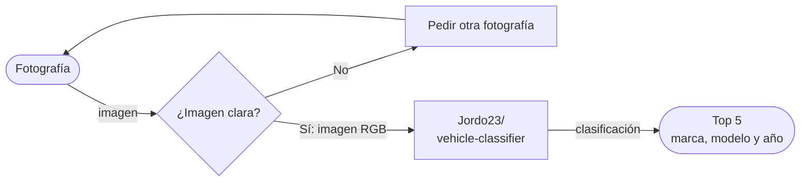
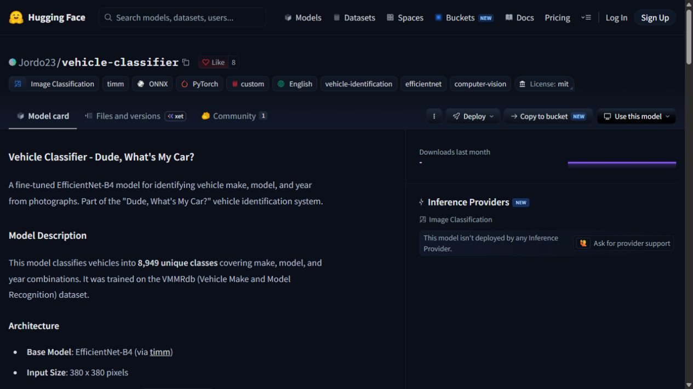

# Clasificador de vehículos

Identificación orientativa de marca, modelo y año de un vehículo a partir de una fotografía.

**Proyecto integrador · Herramientas de IA**  

## Integrantes

| Nombre |
|---|
| Cristopher Cortés Reynoso |
| Daniel Juárez |
| Raúl Chessani |
| Erik Aguirre |

## 1. Caso de uso

El proyecto apoya la catalogación inicial de vehículos en un inventario académico o de autos usados. Una persona proporciona una fotografía y recibe cinco posibles combinaciones de marca, modelo y año. Después revisa las sugerencias antes de incorporarlas al catálogo.

- **Entrada:** fotografía RGB de un vehículo, preferentemente completa, nítida y bien iluminada.
- **Salida:** cinco etiquetas de marca, modelo y año con sus puntuaciones; son sugerencias sujetas a revisión humana.

## 🔀 Cómo funciona

El rombo representa una revisión visual propuesta antes de la clasificación. La imagen se redimensiona a 380 × 380 y se normaliza antes de entrar al modelo. Se muestran las cinco clases mejor puntuadas para revisión humana. El diagrama usa píldoras, rectángulos y un rombo, con flechas etiquetadas.

## 2. Modelo abierto elegido

| Dato | Respuesta |
|---|---|
| Identificador | `Jordo23/vehicle-classifier` |
| Model Card | [Ficha publicada por Jordo23](https://huggingface.co/Jordo23/vehicle-classifier) |
| Tarea | `image-classification` |
| Arquitectura | EfficientNet-B4 con `timm` |
| Entrada del modelo | Imagen RGB de 380 × 380 píxeles |
| Salida | 8,949 combinaciones de marca, modelo y año |
| Parámetros | ≈19 M declarados por el autor; ≈33.6 M estimados al considerar la capa final de 8,949 clases |
| Licencia declarada | MIT |
| Limitación declarada | Puede fallar con vehículos parcialmente ocultos, ángulos inusuales y vehículos antiguos, raros o modificados. No identifica el color |

Los datos anteriores proceden de la Model Card consultada el 13 de octubre de 2026. La arquitectura y el número de clases describen el modelo publicado; no equivalen a una prueba de desempeño realizada por el equipo.

## 3. Viabilidad de hardware

Para pesos en FP16 se estima la memoria mínima con dos bytes por parámetro:

$$
\text{Memoria de pesos (GB)} \approx \frac{N_{\text{parámetros}}\times 2}{10^9}
$$

La cifra de ≈19 M de la Model Card es aproximada. Como referencia, [timm reporta ≈19.34 M para EfficientNet-B4 con 1,000 clases](https://raw.githubusercontent.com/huggingface/pytorch-image-models/main/results/results-imagenet.csv), y su [configuración indica 1,792 características de salida](https://huggingface.co/timm/efficientnet_b4.ra2_in1k/blob/main/config.json). Al sustituir esa capa por una de 8,949 clases:

$$
N \approx 19{,}340{,}000+(8{,}949-1{,}000)(1{,}792+1) \approx 33.6\times10^6
$$

$$
\text{Memoria de pesos FP16} \approx \frac{33.6\times10^6\times2}{10^9}=0.0672\ \text{GB}
$$

Esto equivale a unos **67.2 MB decimales para los pesos**. Es una estimación de arquitectura, no un conteo medido del archivo del modelo. En FP32, los pesos ocuparían aproximadamente el doble: **134.4 MB**.

- **VRAM disponible en Colab:** no medida en esta sesión; depende de la GPU que se asigne al conectar el entorno.
- **Dónde se ejecutará:** se propone Colab con GPU mediante PyTorch y `timm`. Si no hay GPU, se puede evaluar la inferencia en CPU, con su rendimiento por medir.
- **Justificación:** el tamaño estimado de los pesos hace razonable probarlo en Colab. La memoria real será mayor porque también incluye activaciones, tensores y bibliotecas. Debe verificarse durante la ejecución.
- **Disponibilidad de API:** al consultar la ficha, Hugging Face no mostraba un proveedor de inferencia activo para este modelo; la propuesta consiste en cargarlo en el entorno de trabajo.

## 4. Riesgo ético

- **Riesgo:** una clasificación errónea puede asignar una marca, versión o año incorrectos al inventario. Las fotografías también pueden contener rostros o placas que no son necesarios para la tarea.
- **Mitigación:** mostrar varias sugerencias y exigir revisión humana; permitir corregir la etiqueta; usar imágenes propias o autorizadas y recortar o difuminar rostros y placas antes de procesarlas. No tratar las puntuaciones como certeza ni usar el resultado para identificar a una persona.

## 5. Evidencia

**Fuente:** [Model Card en Hugging Face](https://huggingface.co/Jordo23/vehicle-classifier). **Captura:** 13 de octubre de 2026. La imagen documenta el modelo elegido; no es una prueba de inferencia ni una medición de precisión.

## Notas del proyecto

- [Equipo](Equipo.md)
- [Modelo](Modelo.md)
- [Bitácora](Bit%C3%A1cora.md)

Este README usa enlaces Markdown normales para conservar su compatibilidad con GitHub.
